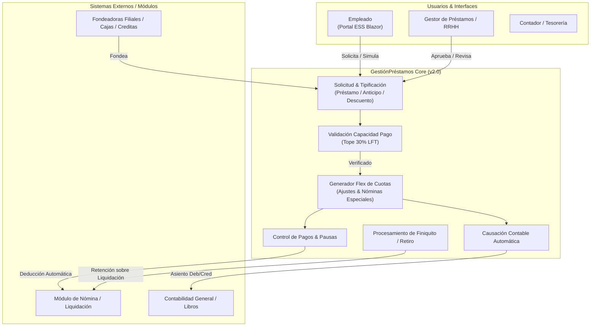
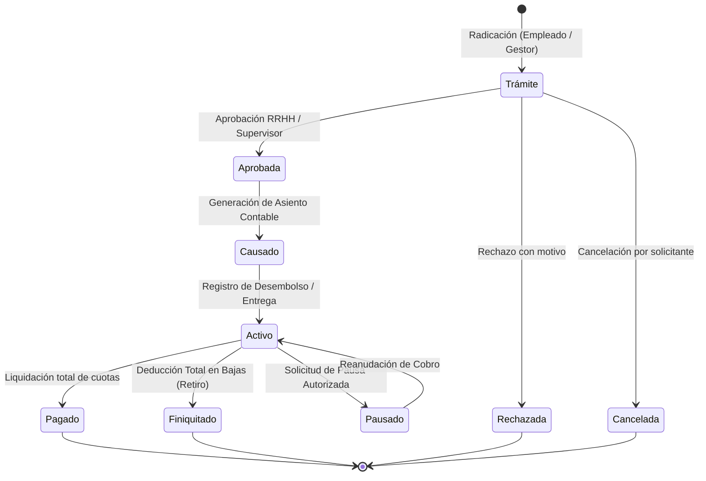
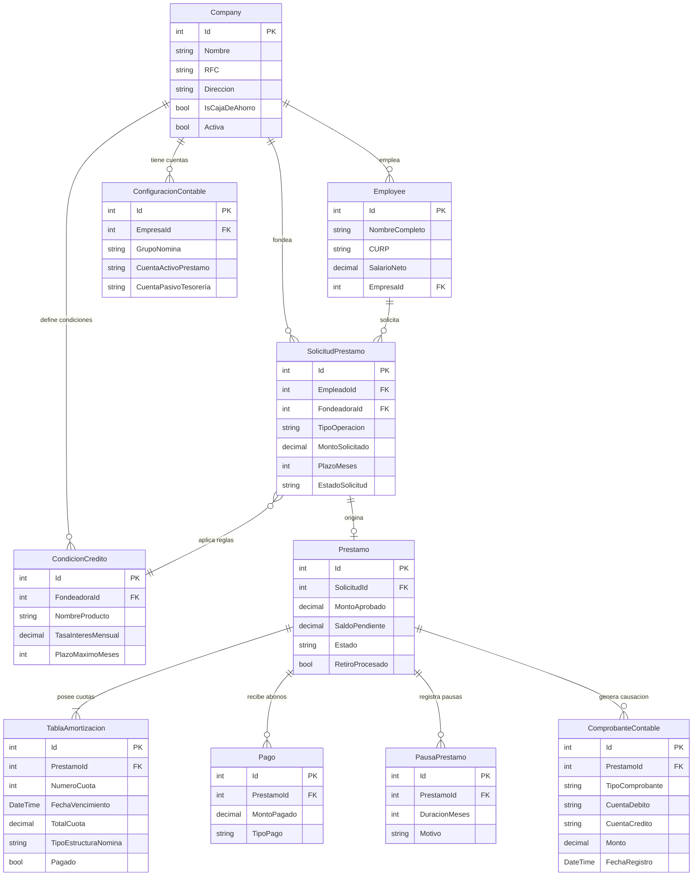
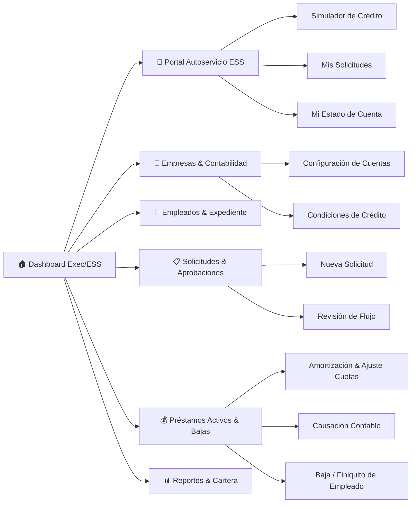

# Documento de Especificación de Requerimientos de Software (SRS)
## Aplicación de Gestión de Préstamos — GestiónPréstamos

| Campo | Detalle |
| ------ | ------ |
| **Versión** | 2.0 |
| **Fecha** | 7 de octubre de 2026 |
| **Autor** | Equipo de Arquitectura de Software & Gestión de Nómina |
| **Estado** | Versión Consolidada con Mejoras Operativas, Contables y Legal-Laborales |

---

## 1. Introducción

### 1.1 Propósito
Este documento establece la Especificación de Requerimientos de Software (SRS) formal para la versión 2.0 de **GestiónPréstamos**, una solución web empresarial integrada para el control, administración, causación contable e integración con nómina de solicitudes de financiamiento, adelantos de sueldo y deducciones internas para colaboradores en grupos corporativos multiempresa y cajas de ahorro.

### 1.2 Alcance del Sistema
El sistema extiende la funcionalidad tradicional de préstamos incorporando una tipificación financiera completa:
1. **Préstamos Tradicionales:** Solicitudes a mediano/largo plazo con fondeo de empresa filial, caja de ahorro o entidad financiera externa (ej. Creditas), calculados mediante el Sistema Francés (cuota fija, amortización capital e interés).
2. **Anticipos de Nómina (Adelantos de Sueldo):** Cobro único en la nómina inmediata por salario ya devengado, sin intereses ni desembolsos de fondeo a plazos.
3. **Otros Descuentos (Cobros Internos):** Deducciones programadas a cuotas sin salida de tesorería (ej. cobro de herramientas, reposición de equipos informáticos o pérdida de activos).
4. **Causación Contable Automática:** Generación automática de comprobantes contables de debito (activo por cobrar) y crédito (pasivo tesorería/cuentas por pagar) al momento de la entrega, e integración de cruce de saldos durante la liquidación periódica de nómina.
5. **Manejo Integral de Finiquitos (Bajas):** Absorción y deducción prioritaria del saldo pendiente sobre la liquidación del contrato de trabajo al retiro del trabajador.
6. **Portal de Autoservicio del Empleado (ESS):** Interfaz para radicación, simulación y seguimiento directo por parte de los trabajadores.

### 1.3 Definiciones y Acrónimos
| Término | Definición |
| ------ | ------ |
| **Fuente Fondeadora** | Entidad financiera proveedora del capital (Empresa Filial, Caja de Ahorro o Entidad Externa como Creditas). |
| **Anticipo de Nómina** | Adelanto de sueldo correspondiente a días trabajados del periodo en curso; cobro a 0% interés en la nómina más próxima. |
| **Descuento Interno** | Cobro programado en N cuotas por conceptos operativos/administrativos sin egreso monetario de tesorería. |
| **Amortización Francesa** | Sistema financiero de cuotas constantes compuestas por capital creciente e interés decreciente. |
| **Causación Contable** | Registro automático del movimiento financiero (débito a Cuenta por Cobrar Empleado y crédito a Pasivo/Tesorería) previo al pago de nómina. |
| **Portal ESS** | Employee Self-Service (Portal de Autoservicio) que permite al empleado simular y radicar sus solicitudes. |
| **Tope LFT** | Límite legal del 30% fijado por la Ley Federal del Trabajo sobre la capacidad de descuento del salario del empleado. |

### 1.4 Stack Tecnológico
| Capa | Tecnología |
| ------ | ------ |
| **Backend** | .NET 10 / ASP.NET Core Web API |
| **Frontend** | Blazor WebAssembly con MudBlazor (Responsive Desktop / Tablet / Mobile) |
| **Base de Datos** | SQL Server / PostgreSQL con Entity Framework Core 10 |
| **Arquitectura** | Clean Architecture (Domain, Application, Infrastructure, API, Client, Shared) |
| **Seguridad & Autenticación** | ASP.NET Core Identity + JWT Tokens con Roles y Permisos Finos |
| **Integraciones** | Motor de Contabilidad General y Módulo de Nómina Electrónica |

---

## 2. Descripción General del Sistema

### 2.1 Perspectiva del Producto

### 2.2 Reglas de Negocio Clave

| # | Regla | Detalle |
| ------ | ------ | ------ |
| **RN-01** | **Multiempresa y Multiseñorío** | Administración jerárquica de N empresas filiales y Cajas de Ahorro consolidadas. |
| **RN-02** | **Préstamos Inter-empresa** | Un colaborador de la Empresa A puede recibir un préstamo otorgado por la Empresa B, Caja de Ahorro o Fondeadora Externa. |
| **RN-03** | **Condiciones por Fondeadora** | Definición independiente de tasas de interés (0% para anticipos y cobros internos), plazos máximos y comisiones. |
| **RN-04** | **Caja de Ahorro (Corto Plazo)** | Préstamos con plazo máximo estricto de 12 meses. |
| **RN-05** | **Amortización Francesa / Cuota Fija** | Cuotas calculadas con fórmula francesa tradicional o cuotas fijas directas para tasa 0%. |
| **RN-06** | **Tope Legal LFT ( Capacidad de Pago )** | La suma total de deducciones por préstamos y adelantos no podrá superar el **30% del salario neto** del colaborador. |
| **RN-07** | **Deducción Prioritaria en Finiquito (Retiros)** | Si un colaborador es dado de baja, el sistema calcula el saldo pendiente total y lo retiene automáticamente de la liquidación o finiquito laboral. |
| **RN-08** | **Reestructuración de Saldo Remanente** | Si el finiquito no cubre la totalidad del adeudo, el saldo restante se reclasifica a cartera personal o cuenta por cobrar individual. |
| **RN-09** | **Causación Contable Previa** | Toda aprobación de préstamo o anticipo genera un comprobante contable de causación antes de la dispersión de fondos. |
| **RN-10** | **Tipificación de Operación** | Diferenciación entre Préstamo (con desembolso e intereses), Anticipo de Nómina (devengado a 1 cuota) y Descuento Interno (sin desembolso). |
| **RN-11** | **Pausas y Prórrogas** | Máximo 2 pausas de cobro por préstamo, congelando intereses durante el lapso de pausa. |
| **RN-12** | **Fondeadoras Externas (Terceros)** | Compatibilidad para consultar Buró de Crédito y migrar saldos a créditos personales al término de la relación laboral. |

### 2.3 Usuarios y Roles del Sistema
* **Empleado (Portal ESS):** Simula créditos, consulta estado de cuenta, radica solicitudes de anticipo/préstamo y descarga comprobantes.
* **Gestor de Préstamos / RRHH:** Administra empleados, valida documentación, aprueba/rechaza solicitudes de nivel estándar y registra entregas.
* **Supervisor / Director de RRHH:** Aprueba montos extraordinarios, autoriza pausas y aprueba condiciones especiales.
* **Contador / Tesorero:** Configura cuentas contables, liquida asientos de causación, efectúa las transferencias y concilia recaudos de nómina.
* **Administrador del Sistema:** Gestión de catálogos, empresas, fondeadoras, parámetros de seguridad y auditoría.

---

## 3. Requerimientos Funcionales

### 3.1 Módulo de Empresas y Fondeadoras
* **RF-01 (Empresas Filiales):** CRUD completo de empresas empleadoras y fondeadoras.
* **RF-02 (Caja de Ahorro):** Gestión de Cajas de Ahorro con tope máximo estricto de 12 meses.
* **RF-03 (Condiciones de Crédito):** Definición de tasas mensuales, montos mínimos/máximos y productos crediticios.
* **RF-03.1 (Fondeadoras Externas - Creditas/Terceros):** Soporte para aliados financieros externos, incluyendo bandera para comisiones de apertura y enlace de cartera.

### 3.2 Módulo de Gestión de Empleados y Portal ESS
* **RF-04 (Registro de Empleados):** Mantenimiento de expediente de personal (CURP/RFC, empresa empleadora, salario neto, fecha de ingreso, cuenta bancaria).
* **RF-05 (Historial Crediticio Interno):** Trazabilidad de solicitudes históricas, saldos activos, comportamiento de pago y mora.
* **RF-06 (Validación Capacidad de Pago LFT 30%):** Control automatizado que prohíbe autorizar cuotas que superen el 30% del salario neto mensual.
* **RF-06.1 (Portal de Autoservicio ESS):** Módulo web interactivo para que el empleado radique y consulte solicitudes de forma autónoma.

### 3.3 Módulo de Solicitudes y Tipología de Operaciones
* **RF-07 (Registro de Solicitudes con Tipificación):**
  * *Préstamo Tradicional:* Selección de fondeadora, tasa, cuotas, plazo.
  * *Anticipo de Nómina:* Cálculo automático sobre días laborados en el ciclo actual, 0% interés, cobro único.
  * *Descuento Interno:* Registro de cobro por herramientas o equipos, asignación de cuotas, sin afectación a caja/tesorería.
* **RF-08 (Flujo Completo de Aprobación):**

### 3.4 Módulo de Préstamos Activos, Amortización y Generador Flexible
* **RF-10 (Registro de Entrega):** Confirmación de transferencia bancaria, cheque o efectivo, generando el préstamo en estado *Activo*.
* **RF-10.1 (Generación de Causación Contable Automática):** Al activar/entregar el préstamo, el sistema genera automáticamente el comprobante contable débito (Cuenta por Cobrar Empleado) y crédito (Pasivo Tesorería).
* **RF-11 (Tabla de Amortización Francesa):** Cálculo de tabla de amortización detallada (capital, interés, saldo restante).
* **RF-11.1 (Ajuste Fino de Cuotas):** Edición manual permitida a Gestores autorizados para ajustar montos o fechas de cuotas específicas.
* **RF-11.2 (Asignación a Nóminas Especiales):** Programación de deducciones dirigidas a nóminas de Aguinaldo, Gratificaciones o Prima Vacacional.
* **RF-12 (Registro de Pagos Ordinarios y Extraordinarios):** Aplicación de abonos desde nómina o depósitos directos.
* **RF-13 (Pagos Anticipados y Recalculo):** Opciones para recalcular tabla de amortización reduciendo plazo o reduciendo valor de cuota.
* **RF-14 (Gestión de Pausas):** Suspensión temporal de cuotas desplazando cronograma sin penalización por mora.
* **RF-15 (Tratamiento de Retiros y Bajas de Empleados):** Módulo de finiquito automático que calcula el saldo adeudado y emite la novedad de descuento para la liquidación final del contrato de trabajo.

### 3.5 Módulo de Integración Contable y Nómina
* **RF-16 (Configuración de Cuentas Contables por Grupo de Nómina):** Mapeo de cuentas de activo (1365 - Préstamos a Trabajadores) y pasivo (2335 - Cuentas por Pagar) por cada grupo de pago.
* **RF-17 (Interface Automatizada de Nómina):** Inyección directa de novedades de descuento en cada corrida periódica de nómina.
* **RF-18 (Cruce de Saldos Contables):** Cierre y conciliación automática del valor descontado en nómina contra la cartera del empleado.

### 3.6 Módulo de Reportes y Dashboard
* **RF-19 (Reporte de Cartera por Fondeadora):** Desglose de capital colocado, saldo vigente, vencido e indicadores de morosidad por empresa o caja.
* **RF-20 (Reporte de Cartera por Empresa Empleadora):** Muestra el endeudamiento de los colaboradores de cada compañía filial.
* **RF-21 (Estado de Cuenta Individual):** Documento PDF oficial descargable por el empleado desde el portal ESS.
* **RF-22 (Dashboard Ejecutivo con KPIs):** Gráficos interactivos de colocación mensual, estado de cartera, distribución por fondeadora y solicitudes en trámite.

---

## 4. Requerimientos No Funcionales

* **RNF-01 (Arquitectura Limpia):** Implementación con separación de responsabilidades: Domain, Application, Infrastructure, Web API, Client (Blazor) y Shared DTOs.
* **RNF-02 (Seguridad & Encriptación):** Autenticación JWT, contraseñas hash con Argon2/PBKDF2, transmisión HTTPS obligatoria y auditoría completa de cambios.
* **RNF-03 (Desempeño):** Tiempos de respuesta menores a 1.5 segundos en operaciones transaccionales y menos de 3 segundos para reportes masivos de nómina.
* **RNF-04 (Responsividad MudBlazor):** Interfaz fluida adaptable a navegadores web de escritorio, tabletas y teléfonos móviles.
* **RNF-05 (Auditoría Integral):** Registro inalterable de usuario, fecha, hora, IP y valor previo/posterior en cambios de estado y modificaciones de cuotas.

---

## 5. Modelo de Datos Refactorizado

### 5.1 Diagrama Entidad-Relación (ERD)

---

## 6. Interfaces de Usuario y Navegación

### 6.1 Mapa de Navegación del Sistema

### 6.2 Catálogo de Pantallas Principales
| Código | Nombre de Pantalla | Descripción |
| ------ | ------ | ------ |
| **UI-01** | Dashboard Principal | KPIs globales, gráficos de dona por fondeadora y resumen de cartera. |
| **UI-02** | Portal ESS Empleado | Vista amigable para solicitar adelantos de sueldo, préstamos y simular cuotas. |
| **UI-03** | Configuración Contable | Mapeo de cuentas contables de activo y pasivo por grupo de nómina. |
| **UI-04** | Registro de Solicitud | Formulario unificado con tipificación (Préstamo, Anticipo, Descuento Interno). |
| **UI-05** | Módulo de Causación | Visualización y confirmación del comprobante contable automático previo al desembolso. |
| **UI-06** | Editor de Amortización | Ajuste fino de fechas, montos de cuota y asignación a nóminas especiales. |
| **UI-07** | Módulo de Finiquitos | Interfaz para liquidar préstamos vigentes contra la nómina de retiro del trabajador. |
| **UI-08** | Reportes de Cartera | Consultas multidimensionales por fondeadora, empresa empleadora y mora. |

---

## 7. Casos de Uso Principales

### CU-01: Radicación de Anticipo de Nómina desde el Portal ESS
* **Actor:** Empleado.
* **Flujo Principal:**
  1. El empleado ingresa al Portal ESS y selecciona *Solicitar Anticipo de Nómina*.
  2. El sistema determina el saldo máximo disponible proporcional a los días laborados en el periodo.
  3. El empleado ingresa el monto deseado (tasa 0%, 1 sola cuota).
  4. El sistema valida que la cuota no supere el 30% del salario neto (RN-06).
  5. El empleado confirma y la solicitud pasa a estado *Trámite*.

### CU-02: Aprobar Préstamo y Generar Causación Contable
* **Actor:** Gestor de Préstamos / Contador.
* **Flujo Principal:**
  1. El Gestor evalúa la solicitud en estado *Trámite*.
  2. Presiona *Aprobar*. El estado cambia a *Aprobada*.
  3. El sistema invoca automáticamente el servicio contable y crea el *Comprobante de Causación* (Débito: Cuenta por Cobrar Empleado, Crédito: Pasivo Tesorería).
  4. La solicitud queda lista para entrega/desembolso.

### CU-03: Retiro de Empleado con Saldo Pendiente (Finiquito)
* **Actor:** Gestor de RRHH / Nómina.
* **Flujo Principal:**
  1. El Gestor registra la baja del colaborador en el módulo de personal.
  2. El sistema detecta préstamos activos con saldo pendiente.
  3. Calcula el total adeudado y genera la novedad de descuento directo sobre la nómina de liquidación de contrato.
  4. Si el finiquito cubre el saldo, el préstamo pasa a estado *Finiquitado*.
  5. Si el finiquito no cubre el total, la diferencia se envía a reclasificación de cartera vencida.

---

## 8. Criterios de Aceptación
1. **CA-01:** El sistema diferencia estrictamente entre Préstamos, Anticipos de Nómina y Descuentos Internos.
2. **CA-02:** Ninguna solicitud puede aprobarse si la deducción proyectada supera el 30% del salario neto (cumplimiento LFT).
3. **CA-03:** Al aprobar e ingresar fecha de entrega, se genera de forma automática el asiento contable de causación.
4. **CA-04:** La corrida de nómina lee e incluye automáticamente la cuota o el saldo de anticipo correspondiente al periodo.
5. **CA-05:** La baja de un empleado retiene el total adeudado sobre su finiquito o liquidación laboral.
6. **CA-06:** Los empleados pueden ingresar desde Blazor ESS para consultar su saldo y simular solicitudes.

---

## 9. Fases de Implementación Sugeridas

| Fase | Módulos e hitos | Prioridad |
| ------ | ------ | ------ |
| **Fase 1: Base & Core** | Reestructuración de modelos, Tipificación de Operaciones, Regla LFT 30% | 🔴 Alta |
| **Fase 2: Contabilidad & Nómina** | Configuración de Cuentas, Causación Automática, Cruce de Saldos | 🔴 Alta |
| **Fase 3: Bajas & Finiquitos** | Módulo de Retiros, Deducción sobre Liquidación Laboral | 🔴 Alta |
| **Fase 4: Autoservicio ESS** | Portal Blazor Empleado, Simulador, Consultas de Estado | 🟡 Media |
| **Fase 5: Generador Flexible** | Ajuste fino de cuotas, Estructuras salariales especiales | 🟡 Media |
| **Fase 6: Analítica & Dashboard** | KPIs ejecutivos, integración con fondeadoras externas (Creditas) | 🟢 Normal |

---

## 10. Resolución de Deuda Técnica (Refactorización)

1. **Unificación de Modelos Duplicados:** Se eliminan las entidades redundantes (`LoanApplication`, `RepaymentSchedule`) en favor del modelo consolidado `SolicitudPrestamo`, `Prestamo` y `TablaAmortizacion`.
2. **Vincular CondicionCredito a Company:** Se establece la relación obligatoria `Company` 1 -> N `CondicionCredito`.
3. **Nuevas Entidades Incorporadas:** `ComprobanteContable`, `ConfiguracionContable` y `PausaPrestamo`.

---

## 11. Aprobación del Documento

| Rol | Nombre | Firma | Fecha |
| ------ | ------ | ------ | ------ |
| **Líder de Arquitectura** | Equipo de Desarrollo .NET | *Aprobado* | 07/10/2026 |
| **Product Owner** | Gestión de Nómina & RRHH | *Aprobado* | 07/10/2026 |
| **Auditor Contable** | Control Financiero | *Aprobado* | 07/10/2026 |
