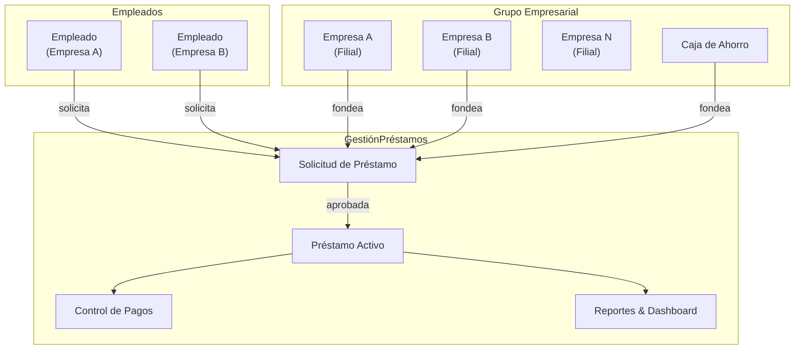
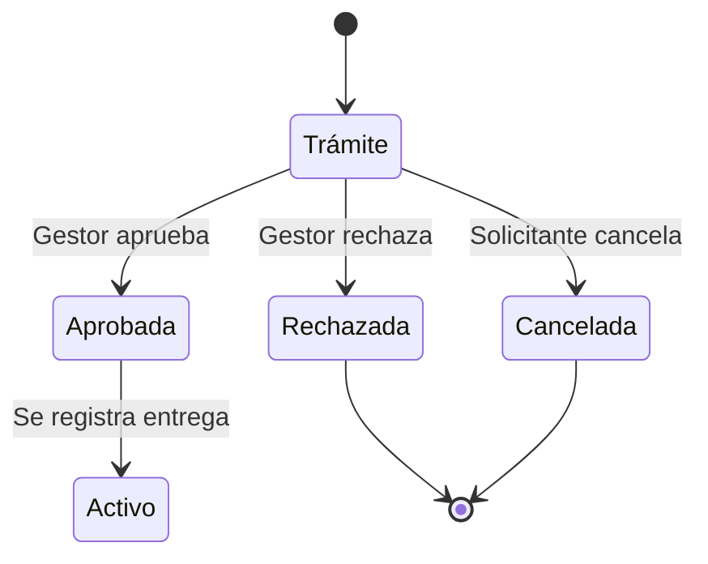
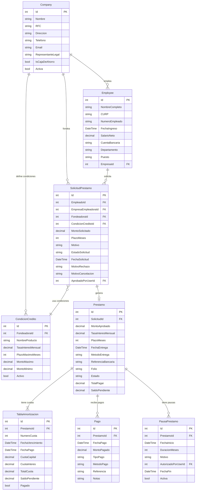
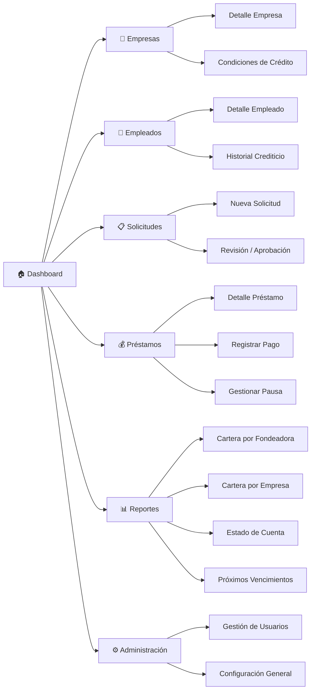

# Documento de Especificación de Requerimientos de Software (SRS)

## Aplicación de Gestión de Préstamos — GestiónPréstamos

| Campo               | Detalle                              |
| ------------------- | ------------------------------------ |
| **Versión**         | 1.0                                  |
| **Fecha**           | 17 de marzo de 2026                  |
| **Autor**           | Equipo de Desarrollo                 |
| **Estado**          | Borrador — Pendiente de aprobación   |

---

## 1. Introducción

### 1.1 Propósito

Este documento describe los requerimientos funcionales y no funcionales para el desarrollo de **GestiónPréstamos**, una aplicación web moderna para el control y gestión de préstamos otorgados a empleados por fuentes fondeadoras (empresas filiales y/o Caja de Ahorro).

### 1.2 Alcance del Sistema

El sistema permitirá:

- Gestionar múltiples empresas filiales y una Caja de Ahorro como fuentes fondeadoras.
- Registrar empleados por empresa con la capacidad de recibir préstamos de cualquier fuente fondeadora del grupo empresarial.
- Administrar el ciclo de vida completo de un préstamo: solicitud → aprobación → entrega → pagos → liquidación.
- Calcular automáticamente tablas de amortización (Sistema Francés) y pagos anticipados.
- Gestionar pausas temporales en préstamos activos.
- Generar reportes de cartera de saldos segmentados por fuente fondeadora.
- Proveer un Dashboard principal con visión ejecutiva del portafolio de préstamos.

### 1.3 Definiciones y Acrónimos

| Término                  | Definición                                                                                                          |
| ------------------------ | ------------------------------------------------------------------------------------------------------------------- |
| **Fuente Fondeadora**    | Entidad que provee los recursos financieros para otorgar el préstamo (una Empresa o la Caja de Ahorro).             |
| **Empresa Filial**       | Compañía perteneciente al grupo empresarial que puede operar como empleadora y/o como fondeadora de préstamos.      |
| **Caja de Ahorro**       | Entidad fondeadora especial cuyas condiciones limitan los préstamos a corto plazo (máximo 12 meses).                |
| **Solicitud de Préstamo**| Registro formal que recoge los datos del empleado, monto, plazo y fuente fondeadora antes de su aprobación.         |
| **Tabla de Amortización**| Desglose cuota a cuota de capital, interés y saldo pendiente del préstamo.                                          |
| **Cartera de Saldos**    | Reporte que muestra el total de capital vigente, vencido y por vencer agrupado por fuente fondeadora.               |
| **Pausa de Préstamo**    | Suspensión temporal del cobro de cuotas de un préstamo activo, con extensión automática del plazo.                  |

### 1.4 Stack Tecnológico

| Capa              | Tecnología                                         |
| ----------------- | -------------------------------------------------- |
| **Backend**       | .NET 10, ASP.NET Core Web API                      |
| **Frontend**      | Blazor WebAssembly con MudBlazor                   |
| **Base de Datos** | SQL Server / PostgreSQL con Entity Framework Core   |
| **Arquitectura**  | Clean Architecture (Domain, Application, Infrastructure, API, Client, Shared) |
| **Autenticación** | ASP.NET Core Identity + JWT                        |

---

## 2. Descripción General del Sistema

### 2.1 Perspectiva del Producto

### 2.2 Reglas de Negocio Clave

| # | Regla | Detalle |
|---|-------|---------|
| RN-01 | **Multiempresa** | El sistema soporta N empresas filiales. Cada una registra y administra sus propios empleados. |
| RN-02 | **Préstamos inter-empresa** | Un empleado de la Empresa A puede recibir un préstamo fondeado por la Empresa B o la Caja de Ahorro. |
| RN-03 | **Condiciones por fondeadora** | Cada fuente fondeadora define su propia **tasa de interés** y **plazo máximo** permitido. |
| RN-04 | **Caja de Ahorro — Corto plazo** | Los préstamos fondeados por la Caja de Ahorro tienen un **plazo máximo de 12 meses**. |
| RN-05 | **Amortización Francesa** | El sistema calcula cuotas fijas con capital creciente e interés decreciente (Sistema Francés). |
| RN-06 | **Pagos anticipados** | Se permite el abono parcial o liquidación total anticipada, recalculando la tabla de amortización. |
| RN-07 | **Pausas de préstamo** | Un préstamo activo puede ser pausado temporalmente; el plazo se extiende por la cantidad de meses en pausa. |
| RN-08 | **Estados de solicitud** | Una solicitud transiciona por: **Trámite → Aprobada / Rechazada / Cancelada**. |
| RN-09 | **Unicidad de préstamo activo** | Un empleado no puede tener más de un préstamo activo por la misma fuente fondeadora simultáneamente (configurable). |

### 2.3 Usuarios del Sistema

| Rol                    | Descripción                                                                 |
| ---------------------- | --------------------------------------------------------------------------- |
| **Administrador**      | Gestiona empresas, caja de ahorro, condiciones de crédito y usuarios.       |
| **Gestor de Préstamos**| Registra solicitudes, aprueba/rechaza, registra entregas, pagos y pausas.   |
| **Supervisor**         | Visualiza reportes de cartera y dashboard, aprueba montos elevados.         |
| **Consultor**          | Acceso de solo lectura a reportes y estado de préstamos.                    |

---

## 3. Requerimientos Funcionales

### 3.1 Módulo de Administración de Empresas (Fuentes Fondeadoras)

#### RF-01: Registro de Empresas Filiales

| Atributo | Detalle |
|----------|---------|
| **Descripción** | Permitir el CRUD completo de empresas filiales del grupo. |
| **Datos requeridos** | Nombre, RFC/NIT, dirección, teléfono, correo, representante legal, estado (activa/inactiva). |
| **Reglas** | El RFC/NIT debe ser único. No se pueden eliminar empresas con préstamos activos. |

#### RF-02: Registro de la Caja de Ahorro

| Atributo | Detalle |
|----------|---------|
| **Descripción** | Registrar la Caja de Ahorro como una fuente fondeadora especial. |
| **Datos requeridos** | Nombre, fondo disponible, fecha de constitución, estado. |
| **Reglas** | Se marca con el flag `IsCajaDeAhorro = true`. Plazo máximo fijo de 12 meses. |

#### RF-03: Configuración de Condiciones de Crédito

| Atributo | Detalle |
|----------|---------|
| **Descripción** | Cada fuente fondeadora define sus propias condiciones de crédito. |
| **Datos requeridos** | Tasa de interés mensual (%), plazo máximo (meses), monto máximo por préstamo, monto mínimo, nombre del producto crediticio. |
| **Reglas** | Si es Caja de Ahorro, el plazo máximo no puede superar 12 meses. Pueden existir múltiples productos por fondeadora. |

---

### 3.2 Módulo de Gestión de Empleados

#### RF-04: Registro de Empleados

| Atributo | Detalle |
|----------|---------|
| **Descripción** | Registrar empleados asociados a una empresa del grupo. |
| **Datos requeridos** | Nombre completo, CURP/RFC, número de empleado, fecha de ingreso, salario neto mensual, cuenta bancaria, departamento, puesto, empresa a la que pertenece. |
| **Reglas** | Cada empleado pertenece a una y solo una empresa. El CURP/RFC debe ser único en el sistema. |

#### RF-05: Historial del Empleado

| Atributo | Detalle |
|----------|---------|
| **Descripción** | Consultar el historial crediticio interno del empleado. |
| **Datos mostrados** | Préstamos anteriores, montos, estados, historial de pagos, adeudos vigentes. |

#### RF-06: Validación de Capacidad de Pago

| Atributo | Detalle |
|----------|---------|
| **Descripción** | El sistema calcula si el empleado tiene capacidad de pago basándose en su salario neto y descuentos existentes. |
| **Regla** | La cuota mensual del préstamo no debe superar un porcentaje configurable del salario neto (por defecto 30%). |

---

### 3.3 Módulo de Solicitudes de Préstamo

#### RF-07: Crear Solicitud de Préstamo

| Atributo | Detalle |
|----------|---------|
| **Descripción** | Permitir el registro de una nueva solicitud de préstamo. |
| **Datos requeridos** | Empleado solicitante, empresa empleadora, fuente fondeadora (empresa o caja de ahorro), producto crediticio, monto solicitado, plazo en meses, motivo/justificación. |
| **Estado inicial** | `Trámite`. |
| **Validaciones** | Monto dentro del rango permitido, plazo dentro del máximo de la fondeadora, empleado sin préstamo activo con la misma fondeadora (si aplica regla RN-09), capacidad de pago suficiente. |

#### RF-08: Flujo de Estados de la Solicitud

| Transición | Responsable | Requisitos |
|------------|-------------|------------|
| Trámite → Aprobada | Gestor/Supervisor | Capacidad de pago verificada, documentación completa. |
| Trámite → Rechazada | Gestor/Supervisor | Motivo de rechazo obligatorio. |
| Trámite → Cancelada | Solicitante/Gestor | Motivo de cancelación obligatorio. |
| Aprobada → Activo | Gestor | Registro de entrega (fecha, método de entrega, referencia). |

#### RF-09: Vista de Solicitudes Pendientes

| Atributo | Detalle |
|----------|---------|
| **Descripción** | Listado filtrable de solicitudes en estado `Trámite` para revisión. |
| **Filtros** | Empresa empleadora, fuente fondeadora, rango de fechas, empleado. |

---

### 3.4 Módulo de Préstamos Activos

#### RF-10: Registro de Entrega del Préstamo

| Atributo | Detalle |
|----------|---------|
| **Descripción** | Registrar la entrega efectiva del dinero al empleado una vez aprobada la solicitud. |
| **Datos requeridos** | Fecha de entrega, método de entrega (transferencia, cheque, efectivo), referencia bancaria, número de folio. |
| **Efecto** | El préstamo pasa a estado `Activo`. Se genera automáticamente la **tabla de amortización** a partir de la fecha de entrega. |

#### RF-11: Generación Automática de Tabla de Amortización

| Atributo | Detalle |
|----------|---------|
| **Descripción** | Calcular y persistir la tabla de amortización usando el **Sistema Francés** (cuota fija). |
| **Datos por cuota** | Número de cuota, fecha de vencimiento, cuota de capital, cuota de interés, total de cuota, saldo pendiente. |
| **Fórmula** | `C = P × [i(1+i)^n] / [(1+i)^n - 1]` donde P=monto, i=tasa mensual, n=plazo. |
| **Caso tasa 0%** | La cuota se calcula como `P / n`. |

#### RF-12: Registro de Pagos

| Atributo | Detalle |
|----------|---------|
| **Descripción** | Registrar cada pago realizado por el empleado. |
| **Datos requeridos** | Fecha de pago, monto pagado, método de pago (nómina, transferencia, efectivo), referencia, notas. |
| **Tipos de pago** | **Ordinario** (cuota normal por nómina), **Extraordinario** (abono adicional), **Liquidación anticipada** (pago total del saldo). |
| **Efecto** | Actualiza saldo pendiente y marca cuotas como pagadas en la tabla de amortización. |

#### RF-13: Pagos Anticipados y Recalculo

| Atributo | Detalle |
|----------|---------|
| **Descripción** | Permitir pagos adelantados parciales o liquidación total anticipada. |
| **Opciones** | Al hacer un pago anticipado, el usuario puede elegir: **a)** Reducir el número de cuotas manteniendo el monto, **b)** Reducir el monto de cuota manteniendo el plazo. |
| **Efecto** | Regenerar la tabla de amortización a partir de la cuota siguiente con el nuevo saldo. |

#### RF-14: Gestión de Pausas

| Atributo | Detalle |
|----------|---------|
| **Descripción** | Pausar temporalmente el cobro de cuotas de un préstamo activo. |
| **Datos requeridos** | Fecha de inicio de pausa, duración en meses, motivo, autorización del supervisor. |
| **Reglas** | Máximo de pausas por préstamo configurable (por defecto: 2 pausas, máximo 3 meses cada una). Durante la pausa **no se generan intereses** (o sí, configurable). |
| **Efecto** | Las fechas de vencimiento de las cuotas restantes se recorren por la cantidad de meses en pausa. Estado del préstamo: `Pausado`. |

#### RF-15: Consulta de Estado de Préstamo

| Atributo | Detalle |
|----------|---------|
| **Descripción** | Vista detallada de un préstamo con toda su información consolidada. |
| **Información** | Datos generales, tabla de amortización con estatus por cuota, historial de pagos, pausas registradas, saldo actual, cuotas pendientes, próxima cuota. |

---

### 3.5 Módulo de Reportes

#### RF-16: Reporte de Cartera de Saldos por Fondeadora

| Atributo | Detalle |
|----------|---------|
| **Descripción** | Generar reporte de cartera agrupado por fuente fondeadora. |
| **Métricas** | Total colocado, saldo vigente, saldo vencido, saldo por vencer, número de préstamos activos, número de préstamos en mora, tasa de morosidad. |
| **Filtros** | Fuente fondeadora, rango de fechas, estado del préstamo. |
| **Formato de salida** | Vista en pantalla con gráficos + exportación a Excel/PDF. |

#### RF-17: Reporte de Cartera por Empresa Empleadora

| Atributo | Detalle |
|----------|---------|
| **Descripción** | Reporte de los préstamos otorgados a empleados de cada empresa, independientemente de la fuente fondeadora. |
| **Métricas** | Total de préstamos activos, montos, saldos, porcentaje de cartera por empresa. |

#### RF-18: Reporte Individual de Empleado

| Atributo | Detalle |
|----------|---------|
| **Descripción** | Estado de cuenta detallado por empleado con todos sus préstamos y pagos. |
| **Formato** | Exportable a PDF para entrega al empleado. |

#### RF-19: Reporte de Vencimientos

| Atributo | Detalle |
|----------|---------|
| **Descripción** | Listado de cuotas próximas a vencer en un periodo configurable (7, 15, 30 días). |
| **Uso** | Alerta temprana para gestión de cobranza. |

---

### 3.6 Módulo de Dashboard

#### RF-20: Dashboard Principal

| Atributo | Detalle |
|----------|---------|
| **Descripción** | Panel ejecutivo con visión global del portafolio de préstamos. |

**KPIs (Indicadores Clave):**

| KPI | Descripción |
|-----|-------------|
| Total Colocado | Suma de todos los montos de préstamos activos |
| Saldo Vigente | Capital pendiente de cobro con cuotas al corriente |
| Saldo Vencido | Capital pendiente de cuotas fuera de fecha |
| Número de Préstamos Activos | Conteo total de préstamos en estado `Activo` |
| Número de Solicitudes en Trámite | Solicitudes pendientes de revisión |
| Tasa de Morosidad | `(Saldo Vencido / Saldo Total) × 100` |
| Recuperación Mensual | Total de pagos recibidos en el mes actual |

**Gráficos Requeridos:**

| Gráfico | Tipo | Descripción |
|---------|------|-------------|
| Distribución por Fondeadora | Gráfico de dona/pie | Porcentaje de cartera por cada fuente fondeadora |
| Evolución de Colocación | Gráfico de líneas | Montos colocados por mes en los últimos 12 meses |
| Estado de Cartera | Gráfico de barras apiladas | Vigente vs. vencido por fondeadora |
| Top Empleados por Saldo | Tabla/ranking | Los 10 empleados con mayor saldo pendiente |
| Solicitudes Recientes | Timeline/lista | Últimas solicitudes registradas con su estado |

---

## 4. Requerimientos No Funcionales

### 4.1 Arquitectura

| Requisito | Detalle |
|-----------|---------|
| **RNF-01** | Arquitectura Limpia (Clean Architecture) con separación en capas: Domain, Application, Infrastructure, API, Client, Shared. |
| **RNF-02** | Patron Repository + Unit of Work para acceso a datos. |
| **RNF-03** | CQRS con MediatR para separar comandos y consultas. |
| **RNF-04** | Validación con FluentValidation en la capa Application. |
| **RNF-05** | Mapeo de objetos con AutoMapper o Mapster. |

### 4.2 Seguridad

| Requisito | Detalle |
|-----------|---------|
| **RNF-06** | Autenticación con ASP.NET Core Identity y tokens JWT. |
| **RNF-07** | Autorización basada en roles (Administrador, Gestor, Supervisor, Consultor). |
| **RNF-08** | Registro de auditoría: cada acción relevante (crear, aprobar, rechazar, pagar) debe registrar usuario, fecha/hora y datos del cambio. |
| **RNF-09** | Contraseñas con política fuerte (mínimo 8 caracteres, mayúscula, número, carácter especial). |
| **RNF-10** | Protección CSRF y validación de entrada contra XSS e inyección SQL. |

### 4.3 Rendimiento y Escalabilidad

| Requisito | Detalle |
|-----------|---------|
| **RNF-11** | Tiempo de respuesta < 2 segundos para operaciones CRUD. |
| **RNF-12** | Reportes de cartera deben generarse en < 5 segundos para hasta 10,000 préstamos. |
| **RNF-13** | Paginación obligatoria en listados con más de 50 registros. |
| **RNF-14** | Caché en memoria para catálogos y datos poco volátiles. |

### 4.4 Usabilidad

| Requisito | Detalle |
|-----------|---------|
| **RNF-15** | Interfaz responsiva (desktop, tablet, mobile) usando MudBlazor. |
| **RNF-16** | Diseño moderno con temas oscuro/claro, paleta de colores profesional. |
| **RNF-17** | Navegación intuitiva con menú lateral, breadcrumbs y búsqueda global. |
| **RNF-18** | Notificaciones en pantalla (Snackbar) para operaciones exitosas y errores. |
| **RNF-19** | Formularios con validación en tiempo real y mensajes descriptivos. |
| **RNF-20** | Exportación a Excel y PDF en todos los reportes. |

### 4.5 Mantenibilidad

| Requisito | Detalle |
|-----------|---------|
| **RNF-21** | Código documentado con XML comments en interfaces públicas. |
| **RNF-22** | Pruebas unitarias con cobertura mínima del 80% en la capa Domain y Application. |
| **RNF-23** | Migraciones de base de datos versionadas con EF Core Migrations. |
| **RNF-24** | Logging estructurado con Serilog. |

---

## 5. Modelo de Datos

### 5.1 Diagrama Entidad-Relación

### 5.2 Entidades Principales

| Entidad | Descripción | Proyecto actual |
|---------|-------------|-----------------|
| `Company` | Empresa filial o Caja de Ahorro | Ya existe — requiere ampliación |
| `Employee` | Empleado de una empresa | Ya existe — requiere ampliación |
| `CondicionCredito` | Producto crediticio con tasa y plazo | Reemplaza a `LoanProduct` |
| `SolicitudPrestamo` | Solicitud formal de un préstamo | Reemplaza a `LoanApplication` |
| `Prestamo` | Préstamo activo con entrega efectuada | Ya existe — requiere ampliación |
| `TablaAmortizacion` | Cuotas calculadas del préstamo | Ya existe — sin cambios mayores |
| `Pago` | Registro de un pago realizado | Ya existe — requiere ampliación |
| `PausaPrestamo` | Pausa temporal de un préstamo | **Nueva entidad** |

---

## 6. Interfaces de Usuario

### 6.1 Mapa de Navegación

### 6.2 Pantallas Principales

| # | Pantalla | Tipo | Descripción |
|---|----------|------|-------------|
| UI-01 | Dashboard | Página principal | KPIs, gráficos de cartera, solicitudes recientes |
| UI-02 | Lista de Empresas | CRUD + Listado | Grid con filtros, botón de nueva empresa |
| UI-03 | Detalle de Empresa | Formulario + Tabs | Datos generales, condiciones de crédito, empleados |
| UI-04 | Lista de Empleados | CRUD + Listado | Grid con filtros por empresa, búsqueda |
| UI-05 | Detalle de Empleado | Formulario + Tabs | Datos personales, historial crediticio |
| UI-06 | Lista de Solicitudes | Listado + Filtros | Grid con filtros por estado, fondeadora, fechas |
| UI-07 | Nueva Solicitud | Wizard/Stepper | Paso 1: Empleado, Paso 2: Condiciones, Paso 3: Confirmación |
| UI-08 | Revisión de Solicitud | Formulario | Datos de la solicitud + botones Aprobar/Rechazar/Cancelar |
| UI-09 | Lista de Préstamos | Listado + Filtros | Grid con filtros por estado, fondeadora, empresa |
| UI-10 | Detalle de Préstamo | Vista detallada | Tabla de amortización, historial de pagos, pausas |
| UI-11 | Registrar Pago | Modal/Formulario | Monto, tipo, método, referencia |
| UI-12 | Gestionar Pausa | Modal/Formulario | Duración, motivo, impacto en cuotas |
| UI-13 | Reporte de Cartera | Dashboard de reportes | Gráficos + tablas + botones de exportación |
| UI-14 | Estado de Cuenta | Reporte individual | Datos del empleado + tabla de pagos + saldo |
| UI-15 | Gestión de Usuarios | CRUD | Usuarios del sistema, roles, permisos |

---

## 7. Casos de Uso Principales

### CU-01: Registrar Nueva Solicitud de Préstamo

| Campo | Detalle |
|-------|---------|
| **Actor** | Gestor de Préstamos |
| **Precondiciones** | Empleado registrado, fuente fondeadora activa con condiciones de crédito vigentes. |
| **Flujo principal** | 1. Seleccionar empleado. 2. Seleccionar fuente fondeadora. 3. Seleccionar producto crediticio. 4. Ingresar monto y plazo. 5. Sistema valida capacidad de pago. 6. Sistema genera previsualización de tabla de amortización. 7. Confirmar solicitud → Estado = `Trámite`. |
| **Flujo alternativo** | 5a. Capacidad de pago insuficiente → Mostrar alerta, permitir ajustar monto/plazo. |
| **Postcondiciones** | Solicitud creada con estado `Trámite`, notificación enviada al supervisor. |

### CU-02: Aprobar o Rechazar Solicitud

| Campo | Detalle |
|-------|---------|
| **Actor** | Gestor / Supervisor |
| **Precondiciones** | Solicitud en estado `Trámite`. |
| **Flujo principal** | 1. Revisar datos de la solicitud y capacidad de pago. 2. **Aprobar**: confirmar → Estado = `Aprobada`. 3. **Rechazar**: ingresar motivo → Estado = `Rechazada`. |
| **Postcondiciones** | Solicitud actualizada. Si aprobada, habilitada para registro de entrega. |

### CU-03: Registrar Entrega y Generar Amortización

| Campo | Detalle |
|-------|---------|
| **Actor** | Gestor de Préstamos |
| **Precondiciones** | Solicitud en estado `Aprobada`. |
| **Flujo principal** | 1. Ingresar datos de entrega (fecha, método, referencia). 2. Sistema genera entidad `Prestamo` con estado `Activo`. 3. Sistema calcula y persiste tabla de amortización. 4. Se actualiza el folio del préstamo. |
| **Postcondiciones** | Préstamo activo con tabla de amortización lista. |

### CU-04: Registrar Pago (Ordinario o Anticipado)

| Campo | Detalle |
|-------|---------|
| **Actor** | Gestor de Préstamos |
| **Precondiciones** | Préstamo en estado `Activo`. |
| **Flujo principal** | 1. Seleccionar préstamo. 2. Ingresar monto, tipo y método de pago. 3. Si es **pago ordinario**: marcar cuota(s) como pagadas. 4. Si es **pago anticipado**: elegir entre reducir plazo o reducir cuota, regenerar tabla. 5. Actualizar saldo pendiente. |
| **Postcondiciones** | Saldo actualizado, cuotas marcadas, tabla regenerada si aplica. Si saldo = 0 → Estado = `Pagado`. |

### CU-05: Pausar un Préstamo

| Campo | Detalle |
|-------|---------|
| **Actor** | Gestor de Préstamos (con autorización de Supervisor) |
| **Precondiciones** | Préstamo en estado `Activo`, no ha excedido el máximo de pausas. |
| **Flujo principal** | 1. Ingresar duración y motivo. 2. Supervisor autoriza. 3. Estado → `Pausado`. 4. Fechas de cuotas pendientes se desplazan. |
| **Postcondiciones** | Préstamo pausado, tabla de amortización ajustada. |

---

## 8. Criterios de Aceptación

| # | Criterio | Validación |
|---|----------|------------|
| CA-01 | Se pueden registrar N empresas y la caja de ahorro como fondeadoras | CRUD completo funcional |
| CA-02 | Cada fondeadora tiene sus propias condiciones de crédito | Tasa y plazo independientes por fondeadora |
| CA-03 | Un empleado de Empresa A puede recibir préstamo de Empresa B | Préstamo inter-empresa sin errores |
| CA-04 | Caja de Ahorro solo permite préstamos ≤ 12 meses | Validación bloquea plazos > 12 meses |
| CA-05 | Solicitudes siguen el flujo: Trámite → Aprobada/Rechazada/Cancelada | Transiciones de estado correctas |
| CA-06 | La tabla de amortización se genera automáticamente al entregar | Cálculo correcto con Sistema Francés |
| CA-07 | Los pagos anticipados recalculan la tabla | Nuevo saldo y cuotas correctos |
| CA-08 | Las pausas desplazan las fechas de cuotas | Fechas recalculadas correctamente |
| CA-09 | Reporte de cartera por fondeadora muestra datos correctos | Totales cuadran con la base de datos |
| CA-10 | Dashboard muestra KPIs en tiempo real | Datos actualizados tras cada operación |
| CA-11 | La interfaz es responsiva y funcional en mobile y desktop | Verificación en múltiples resoluciones |
| CA-12 | Solo usuarios autorizados acceden a funciones de su rol | Roles y permisos correctamente aplicados |

---

## 9. Fases de Implementación Sugeridas

| Fase | Módulos | Prioridad |
|------|---------|-----------|
| **Fase 1 — Base** | Administración de Empresas, Gestión de Empleados, Condiciones de Crédito | 🔴 Alta |
| **Fase 2 — Core** | Solicitudes de Préstamo, Tabla de Amortización, Entrega de Préstamos | 🔴 Alta |
| **Fase 3 — Operaciones** | Registro de Pagos, Pagos Anticipados, Gestión de Pausas | 🟡 Media |
| **Fase 4 — Reportes** | Reportes de Cartera, Estado de Cuenta, Reporte de Vencimientos | 🟡 Media |
| **Fase 5 — Dashboard** | Dashboard Principal con KPIs y gráficos | 🟢 Normal |
| **Fase 6 — Seguridad** | Gestión de Usuarios, Roles, Auditoría | 🔴 Alta |

---

## 10. Observaciones sobre el Proyecto Existente

> [!IMPORTANT]
> El proyecto actual ya cuenta con una estructura de arquitectura limpia y entidades base. Se identificaron las siguientes observaciones para la evolución del código:

| Observación | Detalle |
|-------------|---------|
| **Modelos duplicados** | Existen dos conjuntos de entidades con propósitos similares (`Prestamo`/`Pago` en español y `LoanApplication`/`RepaymentSchedule` en inglés). Se recomienda **unificar** en un solo modelo coherente. |
| **Entidad `Company`** | Requiere ampliación con campos de contacto, dirección, representante legal y estado activo/inactivo. |
| **Entidad `Employee`** | Requiere campos adicionales: CURP, número de empleado, departamento, puesto. |
| **`LoanProduct` → `CondicionCredito`** | Debe vincularse a la empresa fondeadora (actualmente no tiene relación con `Company`). |
| **Entidad `SolicitudPrestamo`** | Debe incorporar los estados solicitados (Trámite, Aprobada, Rechazada, Cancelada) y distinguir empresa empleadora de fondeadora. |
| **`PausaPrestamo`** | Entidad completamente nueva a crear. |
| **Servicio `CalculadoraAmortizacion`** | Ya funcional con Sistema Francés. Debe extenderse para soportar recálculo por pagos anticipados y ajuste por pausas. |

---

## 11. Aprobación del Documento

| Rol | Nombre | Firma | Fecha |
|-----|--------|-------|-------|
| Product Owner | | | |
| Líder Técnico | | | |
| Stakeholder | | | |
